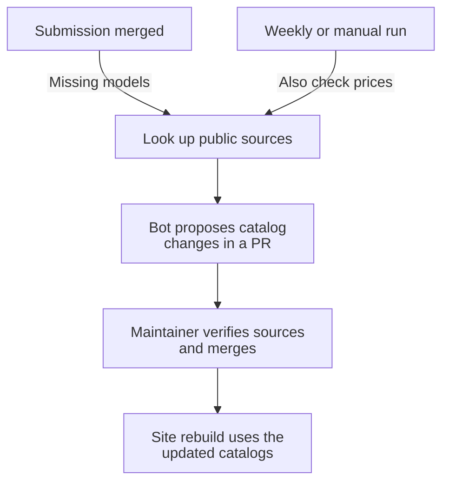

# NIKA Leaderboard

Compare AI agents on network troubleshooting tasks in the [NIKA benchmark](https://github.com/sands-lab/nika). This repository stores reviewed scores and hosts the leaderboard; benchmark runs happen in NIKA.

**[Open the leaderboard](https://sands-lab.github.io/nika/leaderboard/)** · **[Browse submissions](submissions/)** · **[Explore agent trajectories](https://huggingface.co/datasets/nika-bench/nika-trajectories)**

## Explore results

Filter entries by model, agent harness, or benchmark release, then select entries to compare their scores, token use, and estimated costs. Open an entry to see its configuration, task-level results, and linked trajectories.

Rankings use mean root-cause analysis (RCA) F1, with uncertainty estimates to help interpret differences. Costs use public reference prices, not the submitter's infrastructure bill. The [developer guide](docs/development.md#how-results-are-presented) explains ranking and pricing.

## Submit results

### Prerequisites

- A completed official benchmark release run from a [NIKA checkout](https://github.com/sands-lab/nika).
- GitHub CLI authentication (`gh auth login`) and Hugging Face authentication (`uv run hf auth login`), with permission to propose changes.

In a terminal at the root of your **NIKA checkout**, submit the completed run:

```shell
uv run nika leaderboard submit --result_dir results/my-run \
  --name "My Agent" --authors "Your Name" \
  --traj-repo nika-bench/nika-trajectories
```

Replace `results/my-run` with your run directory. Add `--dry-run` to inspect and validate the packages locally without uploading; authentication is not needed for a dry run.

The command opens two pull requests: compact scores here and agent trajectories on Hugging Face. It prints both URLs for review. Maintainers review and merge both; submitting does not publish an entry immediately.

Keep raw traces, packet captures, and full session logs out of this repository. See the [submission guide](https://github.com/sands-lab/nika/blob/main/docs/benchmarks/leaderboard-submission.md) for custom metadata, package requirements, and upload troubleshooting.

## How the catalog stays up to date

The leaderboard keeps model names, release dates, and reference prices separate from submitted scores. New submissions prompt a lookup for missing model information. A weekly check also looks for price changes; maintainers review every proposed catalog update before publication.



For example, [PR #58](https://github.com/sands-lab/nika-leaderboard/pull/58) proposes new price quotes with source links and lists providers that still need manual updates. Previous quotes are retained so new prices do not rewrite historical cost estimates. Missing information stays pending rather than blocking a valid score submission.

This model refresh is separate from the benchmark task catalog, which supplies network size and incident categories. See [catalog maintenance](docs/development.md#catalog-maintenance) for sources, review steps, and local commands.

## Preview the leaderboard locally

### Prerequisites

- Python 3.12+ and [uv](https://docs.astral.sh/uv/).
- Node.js 22.12+ and npm (the project uses Node 22).

Run these commands on your development machine, starting outside the NIKA checkout:

```shell
git clone https://github.com/sands-lab/nika-leaderboard.git
cd nika-leaderboard
uv sync
uv run python scripts/build_leaderboard_data.py --skip-catalog-refresh
cd web
npm ci
npm run dev
```

Open the local URL printed by Vite. The preview uses the committed submissions and catalogs; it does not run the benchmark or refresh prices from the network.

For tests, catalog updates, and deployment, see the [developer guide](docs/development.md).
